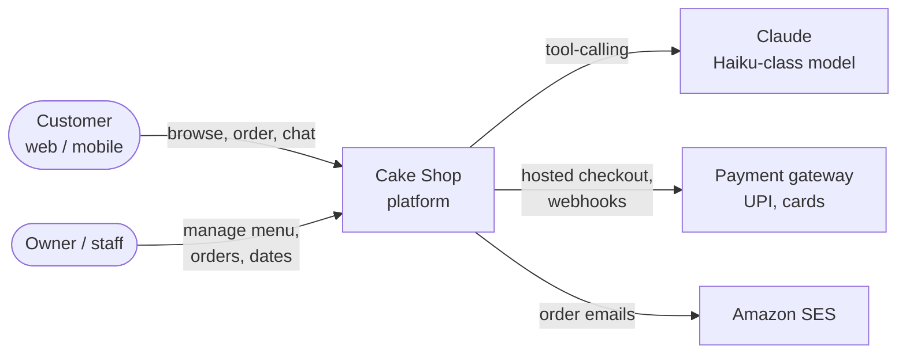
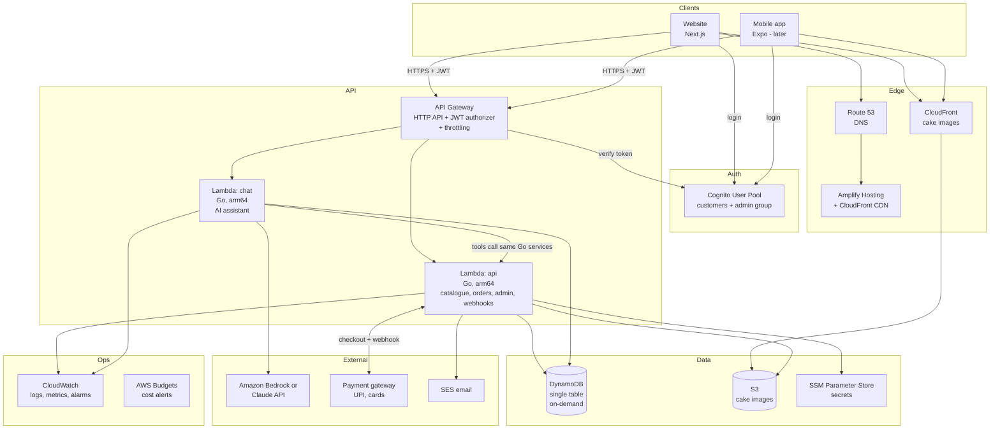
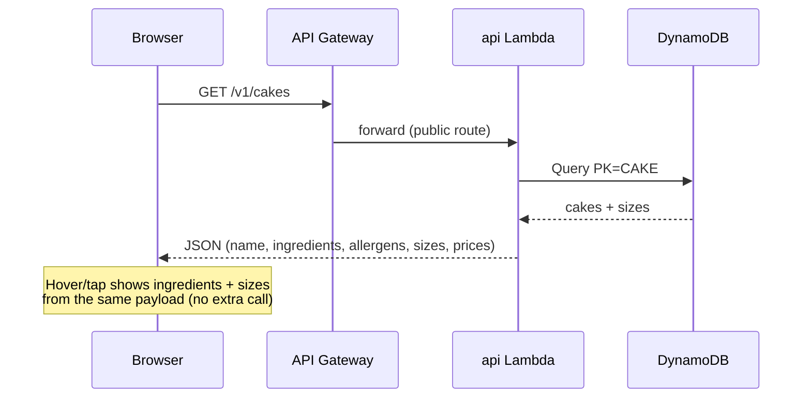
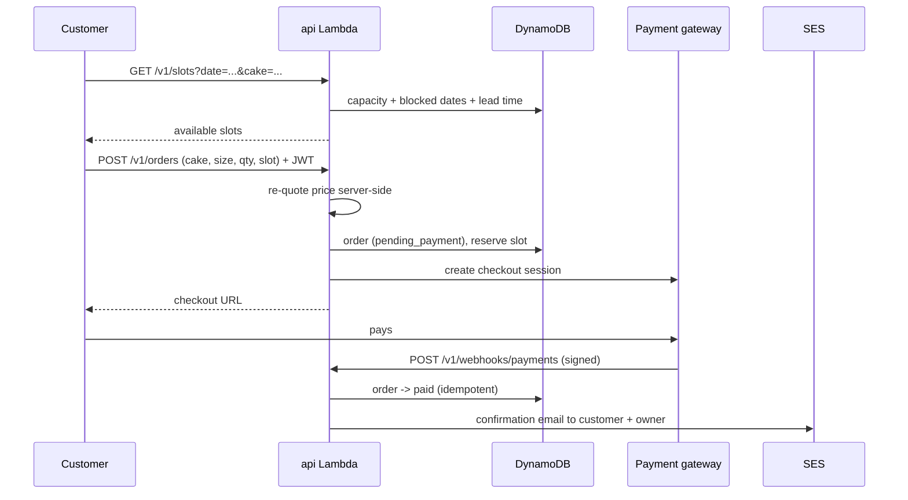
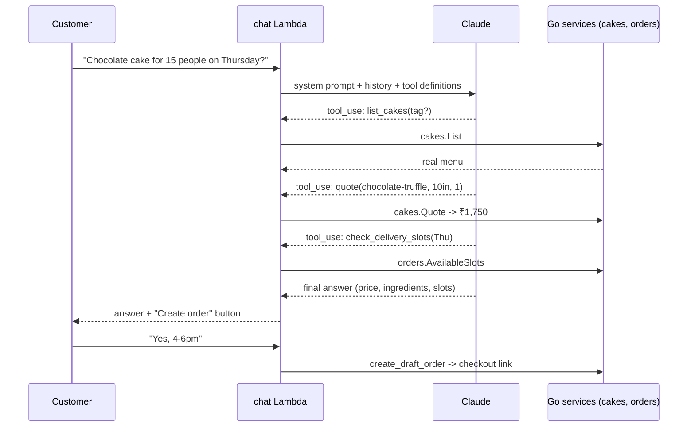

# Architecture Blueprint

> Status: **v1 baseline** (Sprint 0). Update this file whenever the design changes, and record the reason as an ADR in [`adr/`](adr/).

## 1. Goals and constraints

| | |
|---|---|
| Users | 50–100 regular customers in Bangalore, 1 owner + 1–2 staff (admin) |
| Must have | Cake-first menu, hover/tap details (ingredients, sizes, prices), ordering with delivery slot, online payment, AI assistant that quotes real prices and delivery times, owner admin |
| Later | Mobile app (iOS/Android) on the same API, WhatsApp order updates, loyalty |
| Budget | Running cost target **under $40/month** (about ₹3,500) |
| Team | One developer, learning Go |
| Principles | Serverless (no servers to patch), pay-per-use, infrastructure as code, one source of truth for prices |
| Location | Region `ap-south-1` (Mumbai), own AWS account `cakeshop-dev`. See [ADR 0006](adr/0006-region-and-account.md) |

## 2. System context

## 3. AWS component blueprint

> The chat Lambda does not call the api Lambda over the network. Both are built from the same Go module, so the chat's tools call the same `cakes` and `orders` packages directly. "Same code, two deployables."

### Component responsibilities

| Component | Why this choice | Approx. monthly cost at our scale |
|---|---|---|
| **Amplify Hosting** | Git push → deploy for the Next.js site, built-in CDN, preview URLs per branch | $0–5 |
| **Route 53** | Domain DNS, SSL via ACM (free) | ~$0.50 + domain ~$15/yr |
| **API Gateway HTTP API** | Cheapest API Gateway type, native JWT auth with Cognito, throttling | ~$0 (1M requests ≈ $1) |
| **Lambda (Go, arm64)** | Pay per request, Go starts fast, Graviton is cheaper | ~$0 (free tier) |
| **AWS Lambda Web Adapter** | Lets a normal Go `net/http` server run on Lambda unchanged, so local = cloud | free |
| **DynamoDB on-demand** | No server, pay per read/write, point-in-time backup | ~$1–3 |
| **S3 + CloudFront** | Cake photos, uploaded by owner via pre-signed URLs | ~$1–3 |
| **Cognito** | Customer sign-up/login, `admin` group for owner | free tier at this size |
| **SSM Parameter Store** | API keys/secrets (SecureString), free standard tier | $0 |
| **Bedrock / Claude API** | AI assistant, Haiku-class model | ~$2–10 |
| **SES** | Order confirmation emails | ~$0 |
| **CloudWatch + Budgets** | Logs, error alarms, cost alerts | ~$0–3 |
| | **Total** | **≈ $10–40 / month** |

## 4. Key flows

### 4.1 Browse and hover a cake

### 4.2 Order and pay

### 4.3 AI assistant ("Ask the baker")

**AI rules**

1. Prices, sizes, ingredients, allergens and slots come only from tools. The system prompt forbids stating them otherwise.
2. The chat can create a **draft** order and hand over a checkout link. It never takes payment.
3. Limits: max turns per session, max output tokens, per-IP throttling at API Gateway.
4. History stored in DynamoDB with a 30-day TTL (auto-deleted).
5. Replies in English by default; Hindi or Kannada if the client wants (decided in Sprint 6).
6. An eval test set (real questions → expected tool calls) runs in CI before prompt changes ship.

## 5. Data model

See [data-model.md](data-model.md). One DynamoDB table, `PK`/`SK` keys plus one index (`GSI1`).

## 6. API contract

See [api-contract.md](api-contract.md). Versioned under `/v1`, used by web, mobile and the AI tools alike.

## 7. Security

- **No long-lived AWS keys anywhere.** You log in with SSO; GitHub Actions deploys via an OIDC role.
- Secrets in SSM Parameter Store (SecureString), never in git (`.env` is ignored).
- Public routes are read-only (menu, slots). Orders need a Cognito token; `/v1/admin/*` additionally requires the `admin` group, checked in Go.
- Server re-calculates every price; the client never sends one.
- Payment webhooks verified by signature, processed idempotently. No card or UPI details stored.
- S3 buckets fully private; images served only via CloudFront.
- API Gateway throttling (20 req/s, burst 50) protects cost and the AI endpoint.
- Least-privilege IAM per Lambda (SAM policy templates).
- Customer data minimal: name, email, phone, address. Delete-on-request supported, kept in India (Mumbai), in line with India's Digital Personal Data Protection Act.

## 8. Environments and delivery

| | Local | dev | prod |
|---|---|---|---|
| API | `go run ./cmd/server` (in-memory store) | `cakeshop-dev` stack | `cakeshop-prod` stack |
| Website | `localhost:3000` | Amplify branch `develop` | Amplify branch `main` + custom domain |
| Deployed by | you | GitHub Actions on push to `develop` | GitHub Actions on push to `main` |
| Data | seed data | test data | real customers |

Dev runs in its own member account `cakeshop-dev` (AWS Organizations). Prod goes into a client-owned account at launch.

## 9. Observability

- Structured JSON logs (Go `log/slog`) → CloudWatch Logs, 30-day retention.
- Alarms: Lambda errors, API 5xx rate, chat latency, budget thresholds → email.
- X-Ray tracing enabled on Lambdas for slow-request debugging.
- Weekly check during sprint review: cost, errors, AI token usage.

## 10. Mobile app (later)

The Expo/React Native app uses the **same** API, the same Cognito user pool (new app client) and the same chat endpoint. Nothing in the backend changes. Push notifications via Expo push service or Amazon SNS.

## 11. Open questions (tracked as spikes)

| Spike | Question |
|---|---|
| ~~SPIKE-01~~ | **Resolved:** Mumbai `ap-south-1`, separate account. [ADR 0006](adr/0006-region-and-account.md) |
| SPIKE-02 | Bedrock vs direct Claude API. From Mumbai, Bedrock offers Haiku 4.5 with in-India inference or Haiku 5.5 via the global profile. |
| SPIKE-03 | Indian payment gateway with UPI (Razorpay, Cashfree, PayU …): fees, KYC documents the client needs, hosted checkout, webhooks. |
| SPIKE-04 | Delivery: own drivers with time slots, or a delivery partner? Affects the slot model. |
