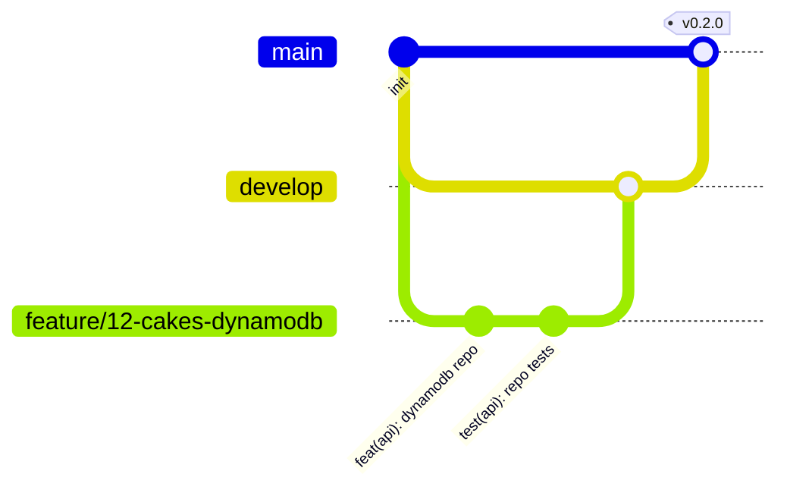

# Git Workflow

## Branches



| Branch | Purpose | Deploys to |
|---|---|---|
| `main` | What customers use. Protected, only merged from `develop` at release | prod |
| `develop` | Integration branch. Everything finished this sprint | dev |
| `feature/<issue#>-<short-name>` | One issue each, short-lived (1–3 days) | — |
| `fix/<issue#>-<short-name>` | Bug fixes | — |
| `spike/<issue#>-<topic>` | Experiments, may never be merged | — |
| `ui/<idea-name>` | Phase 3 frontend experiments (see web/README.md) | Amplify preview |

## Daily loop

```bash
git switch develop && git pull
git switch -c feature/12-cakes-dynamodb
# ... code, test ...
git add -A && git commit -m "feat(api): load cakes from DynamoDB (#12)"
git push -u origin feature/12-cakes-dynamodb
gh pr create --base develop --fill        # or from VS Code / GitHub
# CI green + self-review the diff → squash merge → delete branch
```

## Commit messages: Conventional Commits

`<type>(<area>): <what changed> (#issue)`

Types: `feat`, `fix`, `test`, `refactor`, `docs`, `chore`, `ci`, `perf`.
Examples:

- `feat(api): add quote endpoint (#7)`
- `fix(ai): stop assistant quoting unavailable cakes (#41)`
- `docs(arch): ADR 0006 payment gateway (#19)`

These make `CHANGELOG.md` easy to write at each release.

## Releases

At the end of a milestone: merge `develop` → `main`, tag `vMAJOR.MINOR.PATCH`, add a section to `CHANGELOG.md`.

## Branch protection (GitHub → Settings → Branches)

- `main`: require PR, require `api-ci` to pass, no force push.
- `develop`: require `api-ci` to pass.
