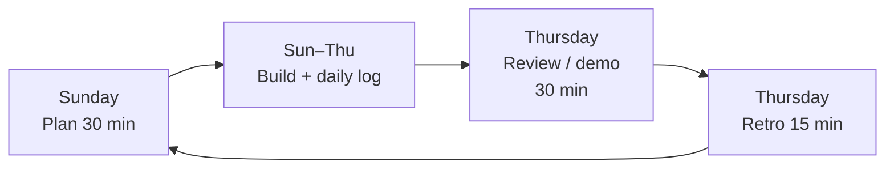

# How We Work: Solo Scrumban

A lightweight mix of **Scrum** (weekly rhythm, goals, demos) and **Kanban** (a visual board, limits on work in progress). Free, runs entirely on GitHub, and sized for one developer with one client. Decision record: [ADR 0005](../architecture/adr/0005-scrumban-process.md).

## Why not plain Scrum, Waterfall or pure Kanban?

| Model | Fit for this project |
|---|---|
| Waterfall | Too rigid. You are learning Go and the client will change their mind about the design. |
| Scrum (by the book) | Daily stand-ups, planning poker and a Scrum Master make no sense for a team of one. |
| Pure Kanban | Great flow, but no rhythm for client demos and no forcing function for deadlines. |
| **Scrumban** | Weekly goal + demo for the client, a Kanban board for daily flow, minimal ceremony. |

## The cycle (1-week sprints)

| Event | When | Time | Output |
|---|---|---|---|
| **Sprint planning** | First work day (Sun in Qatar) | 30 min | Sprint goal (one sentence), issues moved to *Ready*, milestone set |
| **Daily log** | Each work day | 5 min | 3 lines in the sprint file: done / next / blocked |
| **Review / demo** | Last work day (Thu) | 30 min | Show the client working software (dev URL or screen-share). Their feedback becomes new issues |
| **Retrospective** | Last work day (Thu) | 15 min | 1 thing to keep, 1 to change, written in the sprint file |
| **Backlog refinement** | Any time, ~1 hr/week | | Split L stories, write acceptance criteria |

## The board (GitHub Projects, free)

| Column | Meaning | WIP limit |
|---|---|---|
| Backlog | Ideas and future stories | — |
| Ready | Refined, has acceptance criteria, fits this sprint | — |
| In progress | Being built right now | **2** |
| In review | PR open, CI running, self-review | **2** |
| Done | Merged and meets the [Definition of Done](definition-of-done.md) | — |

The WIP limit is the single most useful rule: finish before starting.

## Sizing

No story points. T-shirt sizes:

- **S** – half a day or less
- **M** – 1–2 days
- **L** – 3+ days → must be split before it goes to *Ready*

A week holds roughly **5–7 S/M items** while you learn Go. Measure how many you actually finish (that is your velocity) and plan the next sprint by it.

## Labels

- `type:story`, `type:bug`, `type:spike`, `type:chore`, `type:docs`
- `area:api`, `area:ai`, `area:infra`, `area:web`, `area:mobile`, `area:docs`
- `size:S`, `size:M`, `size:L`
- `priority:must`, `priority:should`, `priority:could` (MoSCoW)

## Phases → milestones

| Phase | Sprints | Milestone |
|---|---|---|
| 0. Foundation | S0 | Architecture + repo + AWS account ready |
| 1. Backend | S1–S7 | Backend v1: API, orders, payments, admin, AI assistant |
| 2. Frontend | S8–S11 | Website live on dev |
| 3. Launch | S12 | Production go-live |
| 4. Documentation | S13 | Handover pack delivered |
| (5. Mobile) | S14–S18 | Optional, separately quoted |

Full sprint-by-sprint plan: [sprint-plan.md](sprint-plan.md).

## Everything is in git

- Sprint notes: `docs/sprints/sprint-NN.md` (copy `_template.md`)
- Decisions: `docs/architecture/adr/`
- Costs and time: `docs/project/cost-log.md`, `docs/project/time-log.md`
- Changes: `CHANGELOG.md`

These files are the raw material for the final project documentation in Phase 4.
